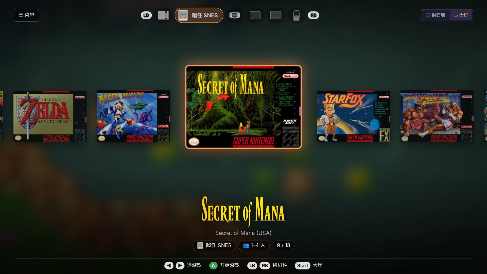
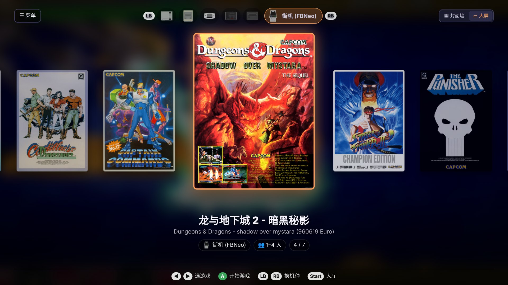
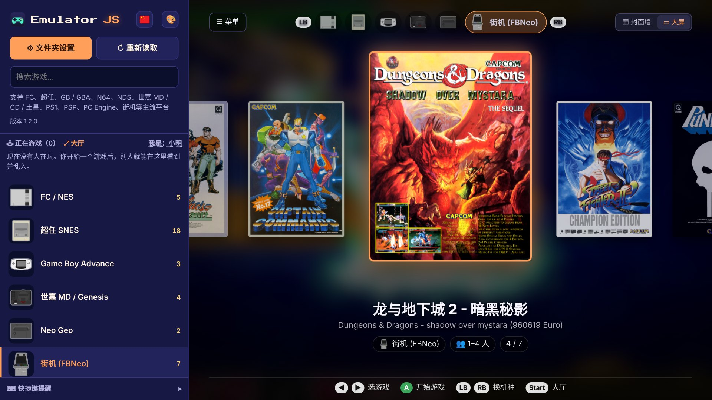

# EmulatorJS 复古游戏机

[English](README.md) | **简体中文**

下载、双击打开就能玩 FC、超任、GB / GBA、N64、NDS、世嘉 MD / CD / 土星、PS1、PSP、PC Engine、街机等老游戏，
还能和同一个 Wi-Fi 或外地的朋友联机（最多 4 人，可以语音、观战）。基于开源项目 [EmulatorJS](https://github.com/EmulatorJS/EmulatorJS)（GPL-3.0）。

https://github.com/user-attachments/assets/cdbd7d1b-7f00-4caf-9875-5c82e2470ef6

*在大厅里点「乱入」，就像走到街机前投个币，加入别人正在玩的游戏。*

**也能在 Meta Quest 3 上玩：**装上安卓版 APK，用 Xbox 手柄在超大的虚拟屏幕上玩。

https://github.com/user-attachments/assets/bbf95288-ae09-4e84-9327-ac9018f0754b

**大屏模式**（1.2.0 新增，电视和 Quest 默认使用）：用十字键或遥控器左右选封面，LB / RB 换机种，背景是选中游戏的画面。
右上角可以和封面墙切换；左上角「☰ 菜单」打开侧栏。

 

## 下载

**[👉 到 Releases 下载最新版](https://github.com/supwang/emulatorjs-releases/releases/latest)**

国内下载慢的话，用 **百度网盘**：https://pan.baidu.com/s/13atBCqmTib1rGp_30279mQ?pwd=6akk （提取码 `6akk`）。两个地方的文件完全一样。

| 你的电脑 | 下载这个 |
|---|---|
| Windows（推荐） | `EmulatorJS-Setup-版本号.exe`：安装版，以后有新版本能自动更新 |
| Windows（不想安装） | `EmulatorJS-版本号-win.zip`：解压后双击 `EmulatorJS.exe` |
| Mac（M1 / M2 / M3 / M4 芯片） | `EmulatorJS-版本号-mac-apple-silicon.dmg` |
| Mac（Intel 芯片） | `EmulatorJS-版本号-mac-intel.dmg` |
| 安卓手机 / 平板 / 电视 | `EmulatorJS-版本号-android.apk`：传到设备上点开安装（需要 Android 7.0 以上） |
| 电脑上的安卓模拟器（MuMu 等） | `EmulatorJS-版本号-android-x86_64.apk` |
| 任何电脑，用浏览器玩 | `EmulatorJS-版本号-folder.zip`：解压后双击 `EmulatorJS-Windows.bat`（Windows）或 `EmulatorJS.command`（Mac） |
| 自己搭外网联机服务器 | `ejs-cloud-setup.sh`：在 Ubuntu 22.04 / 24.04 云服务器上运行 `sudo bash ejs-cloud-setup.sh` |

不知道自己的 Mac 是哪种芯片？点左上角苹果图标 →「关于本机」，「芯片」写着 Apple M 开头的就是 M 系列，写着 Intel 的就是 Intel。

**第一次打开**：软件没有数字签名，系统会拦一下，允许一次就好。
- Windows：出现「Windows 已保护你的电脑」时，点「**更多信息 → 仍要运行**」
- Mac：到「**系统设置 → 隐私与安全性**」，点「**仍要打开**」

## 开始玩

1. 游戏放进「文档 / EmulatorJS」里的 `roms` 文件夹（文件夹版里已经有了），最好按平台分子文件夹：
   `nes`、`snes`、`gb`、`gba`、`n64`、`nds`、`md`、`segacd`、`saturn`、`psx`、`psp`、`pce`、`fbneo`（街机）。
   街机游戏的 zip 不要解压，文件名也不要改。
2. BIOS 文件（PS1、Neo Geo 的 `neogeo.zip`、世嘉 CD）放进 `system` 文件夹；封面图（RetroArch 的 thumbnails）放进 `thumbnails`（可选）。
3. 点「**↻ 重新读取**」，左边选平台，点游戏封面就开始了。

键盘：方向 **W A S D**，开始 **回车**，选择 / 投币 **V**，按键 **J K**（还有 **I L U O**），即时存档 / 读档 **1 / 2**。手柄插上就能用。

**详细使用说明**（下载包里也有）：[English](source/folder/README_US.txt) · [简体中文](source/folder/README_CN.txt) · [繁體中文](source/folder/README_HK.txt) · [日本語](source/folder/README_JP.txt) · [한국어](source/folder/README_KR.txt) · [Español](source/folder/README_ES.txt) · [Français](source/folder/README_FR.txt) · [Deutsch](source/folder/README_DE.txt) · [Português](source/folder/README_BR.txt) · [Русский](source/folder/README_RU.txt)

## 更新

有新版本时，所有版本都会提示这次更新了什么（点左边的版本号也能随时检查）。
**Windows 安装版**点一下就能自动下载、安装；下载慢的话会提示去百度网盘下载。Mac 版、Windows 免安装版、文件夹版、安卓版会给出下载地址，下载后替换旧版本即可，游戏、设置和存档都会保留。

## 源代码

每个版本的完整源代码在 [`source/`](source) 文件夹里（和 EmulatorJS 一样是 GPL-3.0 开源协议），每个版本的下载页也附带「Source code」压缩包。

## 说明

- **本工具不包含任何游戏 ROM 和 BIOS**，请使用你自己合法拥有的游戏。仅供个人怀旧娱乐，禁止用于商业用途。
- 仓库里的 `latest.json` 是程序用来检查新版本的文件，请不要删除。
